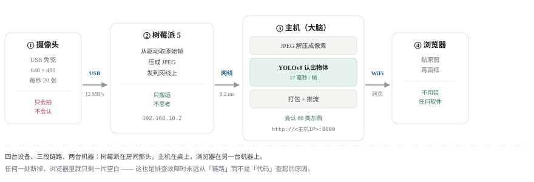
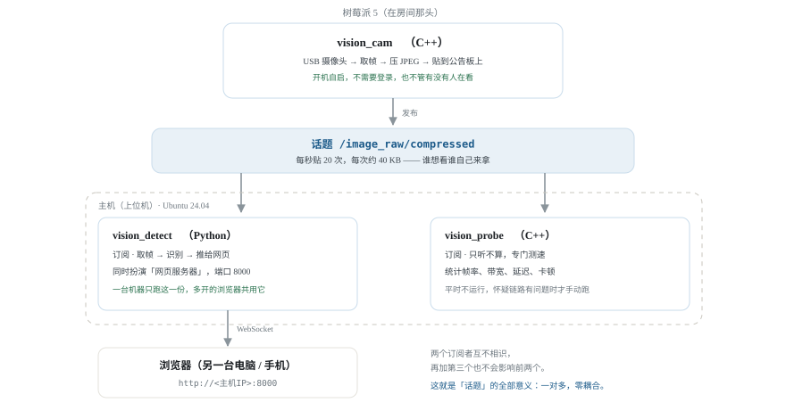

<div align="center">

# 树莓派 5 × ROS 2 × YOLOv8 实时视觉链路

**USB 摄像头 → 树莓派采集 → 千兆 DDS → 主机推理 → 浏览器显示**

端到端 18~24 ms ｜ 稳定 20 fps ｜ 零队列积压 ｜ 浏览器零插件

[](LICENSE)


[快速开始](#快速开始) · [架构](#架构) · [性能实测](#性能实测) · [排障](#排障) · [零基础图解](docs/项目全景解读.html)

</div>



## 这是什么

一台树莓派接 USB 摄像头放在房间那头，一台上位机放在桌上跑 YOLOv8，
任何有浏览器的设备都能实时看到画面和检测框。

和"装个监控 App"的区别在于：画面里的东西是**被认出来的**。
框的位置、类别、置信度都在浏览器里实时画出来，端到端延迟压到了 24 ms 以内。

| 指标 | 实测值 |
|---|---|
| 视频流 | 640×480 @ 20 fps，YUYV 直采，JPEG 质量 80 |
| 网络带宽 | 约 6~7 Mbps（每帧约 40 KB） |
| 链路延迟 | 网线直连 p50 **< 1 ms**，p95 < 5 ms |
| 推理耗时 | YOLOv8n，CPU 8 线程，14~21 ms / 帧 |
| 端到端延迟 | **18~24 ms**（采集 → 浏览器上屏） |
| 树莓派占用 | 单进程 22.9 MB 常驻，启动 < 0.2 s |

## 架构

三个 ROS 2 节点，靠一个话题交接，彼此不需要认识对方：



| 节点 | 所在机器 | 语言 | 职责 |
|---|---|---|---|
| `vision_cam` | 树莓派 5 | **C++** | V4L2 取流 → JPEG → 发布 `/image_raw/compressed`。`VIDIOC_S_CTRL` 直写曝光/增益 |
| `vision_detect` | 主机 | **Python** | 订阅话题 → YOLOv8 推理 → 内置 HTTP + WebSocket 推流，兼网页服务器 |
| `vision_probe` | 主机 | **C++** | 只订阅不推理，测帧率/带宽/帧间隔分位/延迟，排障用 |

**为什么推理是 Python**：OpenCV 4.6 的 DNN 模块加载 YOLOv8 会在检测头 `Add` 节点
断言失败，onnxsim 融合后 `forward()` 又报形状错误；onnxruntime 的 C++ 头文件拿不到。
ultralytics/torch 这条栈没法在 C++ 里等价替换。采集与探针没有这个约束，所以用 C++，
在 Pi 上省掉解释器和 numpy 中转。完整取舍见 [`docs/设计说明.md`](docs/设计说明.md)。

**为什么不会积压**：话题 QoS 固定 `BEST_EFFORT + KEEP_LAST(1)`。
旧的 `usb_cam`（`RELIABLE + KEEP_LAST(100)`）在 20 fps 下会堆出 61 MB 队列，
实测延迟 956 ms 且越跑越长；只留最新一帧后降到亚毫秒。

## 目录结构

```
vision_project/
├── ros2_ws/                      ROS 2 工作空间（节点源码唯一出处）
│   └── src/
│       ├── vision_cam/           [C++ / ament_cmake] 树莓派采集节点
│       ├── vision_detect/        [Python / ament_python] 推理 + 网页服务
│       └── vision_probe/         [C++ / ament_cmake] 链路探针
├── scripts/
│   ├── deploy.sh                 一条命令同步 + 编译到两台机器
│   ├── backup.sh                 生成可恢复的备份快照
│   ├── pi/                       systemd 单元、安装自启、启停、摄像头自检
│   ├── host/                     启动/停止/状态、桌面快捷方式、下载权重
│   ├── setup/                    环境自检（主机 / 树莓派）、按 MAC 找主机 IP
│   └── tests/ws_check.py         WebSocket 协议自检（握手 + 帧完整性）
├── config/
│   ├── wire-host.xml / wire-pi.xml   Fast DDS 配置（各自有线口白名单）
│   └── chrony-host.conf / -pi.conf   两机时间同步片段
├── docs/
│   ├── 项目全景解读.html          零基础图解：数据流、节点协作、设计取舍
│   ├── 设计说明.md               架构、语言选型、每条取舍的实测依据
│   ├── 验收记录.md               实测数据与复现命令
│   ├── 环境配置清单.md           系统 / ROS / 依赖 / 环境变量 / 启动命令
│   ├── images/                   README 用的架构图
│   └── history/                  早期方案的决策留存
└── legacy_python/                最初的 Python 实现（仅作对照，不参与运行）
```

## 快速开始

### 0. 硬件

- 树莓派 5（4 GB 起）+ 官方 27W 电源（普通 5V/3A 会把 USB 口限流到 600 mA，画面会掉帧）
- UVC 免驱 USB 摄像头（`/dev/video0`）
- 上位机：x86_64，8 核以上（推理是 CPU 跑的）
- 一根网线（可选但强烈推荐：直连后延迟从毫秒级抖动的 WiFi 变成亚毫秒）

### 1. 两端装依赖

两端都要：

```bash
sudo apt update
sudo apt install -y ros-jazzy-ros-base libopencv-dev python3-colcon-common-extensions
```

树莓派另加 `v4l-utils`；主机另建 venv 装推理栈：

```bash
# 主机：venv 必须带 --system-site-packages，否则找不到 rclpy
python3 -m venv --system-site-packages ~/venv

# torch 单独装 CPU 版，否则会拉 2 GB 的 CUDA 包
~/venv/bin/pip install torch==2.15.0+cpu torchvision==0.29.1+cpu \
    --index-url https://download.pytorch.org/whl/cpu

~/venv/bin/pip install -r ros2_ws/src/vision_detect/requirements.txt
```

> numpy 必须留在 1.x。cv2 4.10 与 torch 2.15 都是按 numpy 1.x 的 C-API 编译的，
> 升到 2.x 直接 import 失败。

### 2. 取代码与权重

```bash
git clone https://github.com/FFFantasy11/ros2-yolo-vision-link.git ~/vision_project
cd ~/vision_project

# 主机上：下载 YOLOv8n 权重到 ~/yolov8n.pt（仓库不放二进制）
bash scripts/host/fetch_model.sh
```

### 3. 编译

```bash
cd ros2_ws
source /opt/ros/jazzy/setup.bash

# 树莓派
colcon build --packages-select vision_cam --cmake-args -DCMAKE_BUILD_TYPE=Release

# 主机
colcon build --packages-select vision_detect vision_probe --symlink-install
```

### 4. 联网（可选）

不插网线也能跑，走 WiFi 即可，只是帧间隔的 p99 会从 52 ms 抖到 210 ms。

想走有线直连就配一段静态网段（`192.168.10.0/24`，两边都不设网关）：

| 机器 | 接口 | 地址 |
|---|---|---|
| 主机 | 有线口 | `192.168.10.1/24` |
| 树莓派 | `eth0` | `192.168.10.2/24` |

然后把 DDS 绑定到有线口——两端内容只差白名单里那个地址：

```bash
cp config/wire-host.xml config/wire.xml    # 主机
cp config/wire-pi.xml   config/wire.xml    # 树莓派
```

`config/wire.xml` 存在时脚本会自动启用它；不存在就走默认传输，不会报错。

### 5. 启动

**树莓派**（前台运行，`Ctrl-C` 停）：

```bash
bash scripts/pi/start_cam.sh
```

**主机**（后台起服务并自动打开浏览器）：

```bash
bash scripts/host/start_detect.sh
```

然后在任意设备的浏览器里打开 `http://<主机地址>:8000`。

启动顺序建议树莓派在前，反了也能起，只是主机会先空转等帧。

## 常用命令

| 操作 | 树莓派 | 主机 |
|---|---|---|
| 启动 | `bash scripts/pi/start_cam.sh` | `bash scripts/host/start_detect.sh` |
| 停止 | `Ctrl-C` 或 `systemctl --user stop vision-cam` | `bash scripts/host/stop_detect.sh` |
| 状态 | `bash scripts/pi/cam_ctl.sh status` | `bash scripts/host/status.sh` |
| 日志 | `journalctl --user -u vision-cam -f` | `tail -f /tmp/vision-detect.log` |
| 环境自检 | `bash scripts/setup/verify_env.sh --pi` | `bash scripts/setup/verify_env.sh` |
| 链路测速 | — | `ros2 run vision_probe probe_node -p seconds:=15.0` |

### 从开发机一键部署到两台机器

```bash
# 先在 ~/.ssh/config 里配好两个别名，或直接用 user@ip
PI_HOST=pi@192.168.10.2 HOST_HOST=me@192.168.1.20 \
    bash scripts/deploy.sh all --build
```

不带 `--build` 则只同步不编译。

## 开机自启与桌面快捷方式

**树莓派**——用户级 systemd + linger，上电即出流，不需要登录、不用 sudo：

```bash
bash scripts/pi/install_service.sh
```

**主机**——在桌面生成"启动 / 停止"两个双击图标：

```bash
bash scripts/host/install_shortcut.sh
```

> 图标双击没反应，多半是缺桌面图标扩展：
> `sudo apt install gnome-shell-extension-desktop-icons-ng`

## 配置

改 YAML 后重启节点即可，不用重编译。

`ros2_ws/src/vision_cam/config/cam.yaml`

| 参数 | 默认 | 说明 |
|---|---|---|
| `device` | `/dev/video0` | 摄像头设备节点 |
| `width` / `height` / `fps` | 640 / 480 / 20.0 | 分辨率与目标帧率 |
| `fourcc` | `YUYV` | 部分模组 MJPG 上限只有 10 fps |
| `quality` | 80 | JPEG 质量，带宽紧张就降到 70 |
| `buffers` | 4 | 必须 > 1，设 1 会让帧率减半 |
| `exposure` | 100 | 单位 100 µs（100 = 10 ms），暗环境调到 200~300 |
| `gain` / `brightness` | 63 / 0 | 固定值，避免自动曝光来回跳 |

`ros2_ws/src/vision_detect/config/detect.yaml`

| 参数 | 默认 | 说明 |
|---|---|---|
| `model` | `~/yolov8n.pt` | 权重路径，支持 `~` 展开 |
| `imgsz` | 640 | 推理输入尺寸 |
| `conf` / `iou` | 0.4 / 0.7 | 置信度与 NMS 阈值 |
| `classes` | `[]` | 空 = 80 类全检；只检人写 `[0]` |
| `threads` | 8 | torch 线程数，按物理核给 |
| `port` / `bind` | 8000 / `0.0.0.0` | 网页服务监听地址 |

环境变量（都可选）：

| 变量 | 默认 | 用途 |
|---|---|---|
| `PI_HOST` / `HOST_HOST` | `pi` / `host` | `deploy.sh`、`backup.sh` 使用的 ssh 目标 |
| `VISION_PYTHON` | `~/venv/bin/python3` | 带 torch 的解释器路径 |
| `VISION_PROJECT` | `~/vision_project` | 项目根目录（脚本默认值） |

## 性能实测

同一套硬件、同一段画面，C++ 采集节点替换 Python 版后的对比：

| 指标 | Python 版 | 本仓库 |
|---|---|---|
| 出流帧率 | 19.9 fps | **20.0 fps** |
| 帧间隔 p95 | 54.5 ms | **52.2 ms** |
| 链路延迟 p50 | 3.6 ms | **< 1 ms** |
| 端到端 | 24.6 ms | **18~24 ms** |
| 树莓派常驻内存 | ~120 MB | **22.9 MB** |
| 树莓派启动耗时 | ~1.5 s | **< 0.2 s** |

复现命令与逐项数据见 [`docs/验收记录.md`](docs/验收记录.md)。

## 排障

| 现象 | 原因 | 处理 |
|---|---|---|
| 浏览器一片空白，`frames` 不涨 | 树莓派没出流 | `bash scripts/pi/cam_ctl.sh status`，看进程与 journal |
| `Device or resource busy` | 自启服务和手动脚本抢摄像头 | `systemctl --user stop vision-cam` 后再手动跑 |
| ping 得通但收不到帧 | 两端 `wire.xml` 用反了或白名单填错 | 主机填 `.1`、Pi 填 `.2`，别混用 |
| 帧间隔 p99 突然变 210 ms | 没插网线却还设了 `FASTRTPS_DEFAULT_PROFILES_FILE` | 删掉 `config/wire.xml` 或取消该环境变量 |
| `ros2 run` 起不来检测节点 | 系统 python 没有 torch | 用 `scripts/host/start_detect.sh`，或设 `VISION_PYTHON` |
| 双击桌面图标毫无反应 | 脚本加了 `set -u`，ROS 的 `setup.bash` 引用未定义变量后静默退出 | 保持 `set -o pipefail`，不要加 `-u` |
| 串口命令把 SSH 会话自己杀了 | `pkill -f "xxx.py"` 匹配到了自己的命令行 | 用 pidfile，或 `pkill -f "xxx[.]py"` |
| 帧率只有 10 fps | 用了 MJPG，或 `buffers=1`，或自动曝光在来回调 | `fourcc: YUYV`、`buffers: 4`、`lock_controls: true` |
| import cv2 / torch 失败 | numpy 被升到 2.x | `pip install "numpy==1.26.4" --force-reinstall` |

## 文档

| 文档 | 内容 |
|---|---|
| [`docs/项目全景解读.html`](docs/项目全景解读.html) | 零基础图解，含动画流程图。**建议先读这份**（下载后用浏览器打开） |
| [`docs/设计说明.md`](docs/设计说明.md) | 架构与每条技术取舍的实测依据 |
| [`docs/验收记录.md`](docs/验收记录.md) | 实测数据 + 复现命令 + 历史阶段结论 |
| [`docs/环境配置清单.md`](docs/环境配置清单.md) | 系统 / ROS / 依赖版本 / 环境变量 / 网络 / 时间同步 |
| [`docs/history/`](docs/history/) | 早期方案的决策留存（为什么放弃 MJPG、HLS 等） |

## 已知限制

- **Windows 上只能看网页**，不能直接跑 DDS。Windows 与主机在同一 WiFi 网段时，
  它没有到 `192.168.10.0/24` 的路由，要访问 Pi 的有线口得用 `ssh -J` 跳板。
- **树莓派不跑推理**。Pi 5 跑 YOLOv8n 只有 5~8 fps，所以推理固定在主机。
- **只支持 UVC 免驱摄像头**，且同一时刻只能有一个进程占用设备。
- **单路视频流**。多摄像头需要改 topic 与端口，当前没有做多实例隔离。
- 前端用 canvas 画原图 + 矢量框，没有做 H.264 硬编解码，带宽换的是零插件与零延迟。

## License

[MIT](LICENSE)

---

<details>
<summary><b>English</b></summary>

A real-time vision pipeline for Raspberry Pi 5 + ROS 2 Jazzy + YOLOv8.

A Pi 5 captures 640×480@20fps from a UVC camera over V4L2, compresses each frame to
JPEG and publishes it as `sensor_msgs/CompressedImage` with `BEST_EFFORT + KEEP_LAST(1)`
(so the queue can never build up). A host machine subscribes over a direct 1 GbE link,
runs YOLOv8n inference (~17 ms/frame on CPU) and pushes the original frame plus vector
bounding boxes to any browser over a small WebSocket protocol
(`[4B length][JSON header][JPEG]`). End-to-end latency is 18–24 ms at 20 fps.

Three nodes: `vision_cam` (C++, capture), `vision_detect` (Python, inference + web),
`vision_probe` (C++, link diagnostics). Inference stays in Python because OpenCV 4.6's
DNN module cannot load YOLOv8 and ONNX Runtime C++ headers were not obtainable.

```bash
colcon build --packages-select vision_cam                     # on the Pi
colcon build --packages-select vision_detect vision_probe     # on the host
bash scripts/host/fetch_model.sh                              # download yolov8n.pt
bash scripts/host/start_detect.sh                             # serve on :8000
```

</details>
